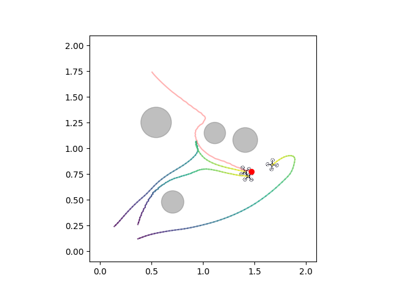
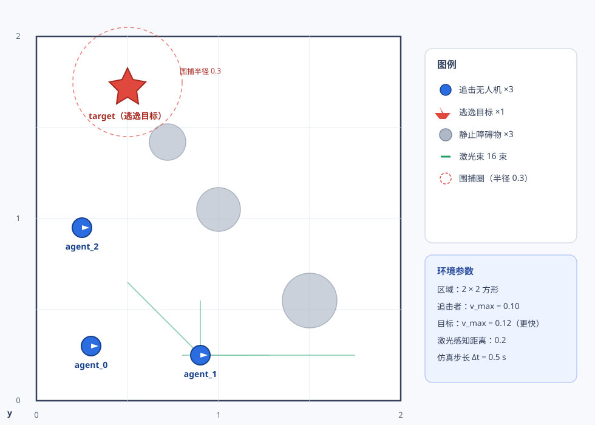
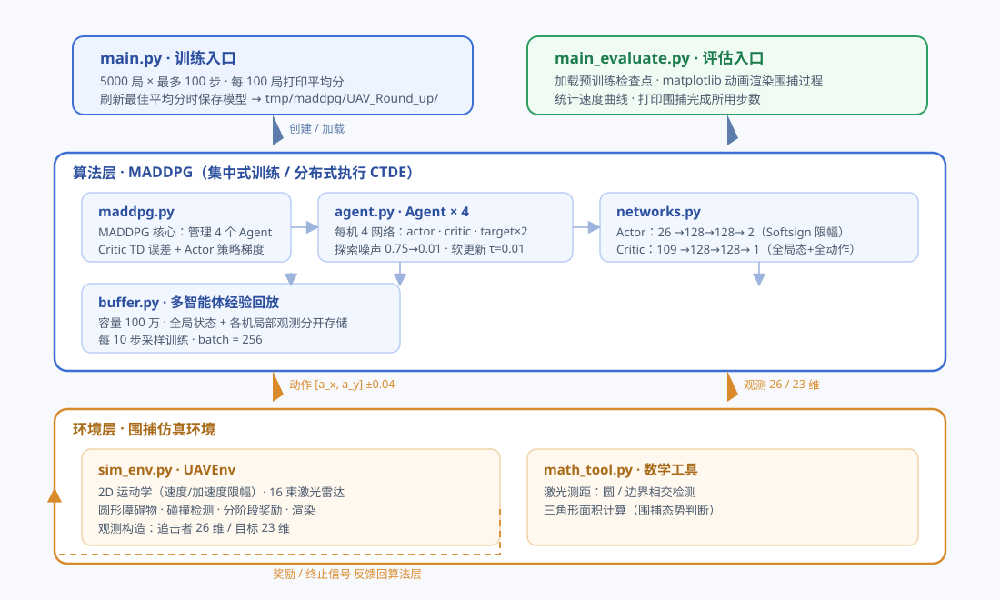
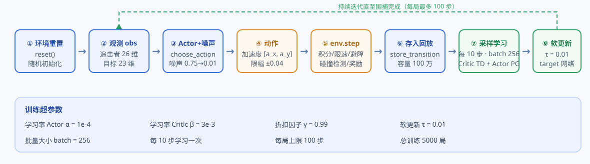

# 🚁 MADDPG 多无人机协同围捕

基于 **MADDPG（多智能体深度确定性策略梯度）** 的多无人机协同围捕控制项目：3 架追击无人机在 2×2 的方形区域内**协同围捕 1 架逃逸速度更快的目标**，途中需避开静止圆形障碍物。

<p align="center">
  
</p>

---

## ✨ 项目特性

- 🎯 **多智能体强化学习（MARL）**：基于 MADDPG 的集中式训练 / 分布式执行（CTDE）范式
- 🧭 **自研仿真环境**：2D 运动学模型、速度/加速度限幅、16 束激光雷达、碰撞检测
- 🏆 **分阶段奖励塑形**：按三角形面积几何关系，引导追击机群完成 *跟踪 → 包围 → 捕获* 的完整围捕流程
- ⚡ **不对称动力学**：逃逸目标比追击者更快，围捕任务具有挑战性
- 📦 **开箱即用**：附带预训练模型检查点，可直接运行评估动画

---

## 🗂️ 项目结构

```
.
├── agent.py            # 单智能体：actor/critic + 目标网络、探索噪声、软更新
├── buffer.py           # 多智能体经验回放（全局状态 + 各机局部观测）
├── maddpg.py           # MADDPG 核心：智能体管理、集中式训练循环
├── networks.py         # Actor / Critic 网络结构定义
├── sim_env.py          # 自研多无人机围捕环境
├── math_tool.py        # 激光测距（圆/边界相交检测）、几何工具
├── main.py             # 训练入口
├── main_evaluate.py    # 评估入口（动画渲染）
├── assets/             # README 配图
├── tmp/maddpg/UAV_Round_up/  # 预训练模型检查点
└── requirements.txt
```

---

## 🧠 环境设计

<p align="center">
  
</p>

| 项目 | 设定 |
|---|---|
| 仿真区域 | 2 × 2 方形平面 |
| 追击者（3 架） | 最大速度 0.10，最大加速度 0.04 |
| 逃逸目标（1 架） | 最大速度 0.12（**更快**），最大加速度 0.05 |
| 激光雷达 | 每机 16 束、360° 均匀分布，感知距离 0.2 |
| 障碍物 | 3 个静止圆形障碍，半径 0.10 ~ 0.15 |
| 仿真步长 | Δt = 0.5 s |

**动作空间**：每个智能体输出 2 维连续加速度 `[a_x, a_y]`，限幅 ±0.04。

**观测空间**（归一化后）：

| 智能体 | 维度 | 组成 |
|---|---|---|
| 追击者 | 26 | 自身位置/速度(4) + 队友位置(8) + 激光(16) + 目标距离/方位角(2) |
| 逃逸目标 | 23 | 自身位置/速度(4) + 激光(16) + 与 3 架追击者距离(3) |

---

## 🏗️ 系统架构

<p align="center">
  
</p>

- **集中式训练**：Critic 输入全局状态 + 所有智能体动作，评估联合策略质量
- **分布式执行**：Actor 仅依据自身局部观测输出动作，可直接部署到单机
- 网络结构：Actor `26→128→128→2`（Softsign 限幅），Critic `109→128→128→1`

---

## 🔄 训练流程

<p align="center">
  
</p>

训练入口为 `main.py`：共 **5000 局**，每局最多 **100 步**；每 **10 步**从经验池采样一个 batch 进行更新；每 100 局打印一次平均分，刷新历史最佳时自动保存模型。

---

## 🎁 奖励设计

奖励由四个部分加权组成，同时目标也获得逃离奖励，形成追逐-博弈：

| 奖励项 | 权重 | 含义 |
|---|---|---|
| r_near（逼近） | 0.7 | 朝目标方向飞行的速度分量，引导追击 |
| r_safe（安全） | 0.4 | 碰撞惩罚 −10；距障碍物越远奖励越高 |
| r_stage（阶段围捕） | 0.01 | 按三角形面积关系分三阶段：跟踪 → 包围 → 捕获 |
| r_finish（完成） | 5×10 | 三机均进入围捕圈（距离 ≤ 0.3）即 +50 并结束本局 |

- **围捕阶段判断**：以追击者三点与目标构成三角形的面积关系判断态势
  - **跟踪**：目标在三角外且距离较远 → 鼓励压缩距离
  - **包围**：目标在三角外但已接近 → 以面积差对数奖励引导合围
  - **捕获**：目标进入三角形内部 → 鼓励进一步收紧
- **逃逸目标奖励**：`clip(10 × ΔΣd, -2, 2)`，鼓励拉开与追击者的距离和

---

## ⚙️ 环境依赖

| 依赖 | 版本 |
|---|---|
| Python | 3.9+（已用 3.9 / 3.10 验证） |
| numpy | 1.26.0 |
| gymnasium | 0.26.2 |
| matplotlib | 3.8.4 |
| pillow | 10.2.0 |
| pandas | 2.1.4 |
| torch | 2.4.0（CPU 可用，CUDA 可选） |

完整依赖见 [requirements.txt](requirements.txt)。

---

## 📦 安装

```bash
git clone https://github.com/<your-account>/MADDPG_Multi_UAV_Roundup.git
cd MADDPG_Multi_UAV_Roundup
pip install -r requirements.txt
```

> 如需 CUDA 加速，请先从 [pytorch.org](https://pytorch.org) 安装对应版本的 PyTorch（如 `torch==2.4.0+cu124`）。

---

## 🚀 快速开始

### 训练模型

```bash
python main.py
```

- 训练 5000 局，最佳模型（按 100 局平均分评判）自动保存至 `tmp/maddpg/UAV_Round_up/`
- 训练得分追加写入 `score_history.csv`

### 评估模型（含动画）

```bash
python main_evaluate.py
```

加载 `tmp/maddpg/UAV_Round_up/` 下的预训练检查点，以 matplotlib 动画实时渲染围捕过程，并打印围捕完成所用步数。

---

## 📈 运行结果

项目已提供一组训练完成的模型检查点（`tmp/maddpg/UAV_Round_up/`，4 个智能体 × 4 个网络），可直接用于评估演示，无需重新训练。

---

## 📚 致谢

- 算法框架参考 [Phil Tabor 的 MADDPG 实现](https://github.com/philtabor/Multi-Agent-Reinforcement-Learning)
- 多目标捕获场景可参考 [Multi-Target Capture](https://github.com/reinshift/KF_AA_MARL)

---

## 📄 License

本项目基于 [MIT License](LICENSE) 开源。
